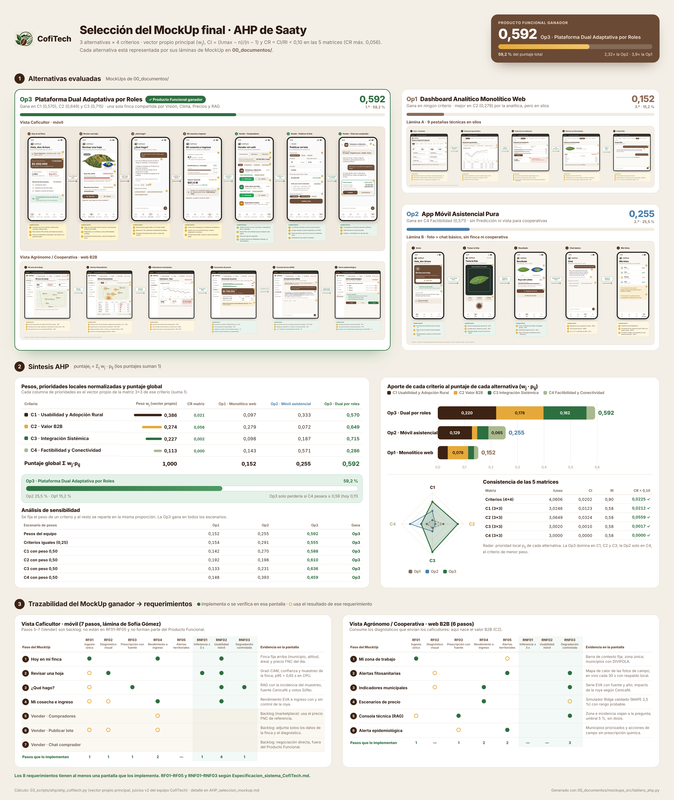

# Tablero AHP + MockUps · Selección del Producto Funcional de CofiTech

*Este tablero une el análisis AHP (`AHP_seleccion_mockup.md`) con las láminas de MockUp de `00_documentos/`. Todas sus cifras salen de `03_scripts/ahp/ahp_cofitech.py` (vector propio principal); el tablero se regenera con `python 00_documentos/mockups_src/tablero_ahp.py`.*

## 1. Alternativas evaluadas y sus láminas

| Alternativa | Láminas que la representan | Puntaje global | Ranking |
|---|---|---:|---:|
| **Op3 · Plataforma Dual Adaptativa por Roles** (Producto Funcional ganador) | `CofiTech_mockup_sofia.png` (vista Caficultor, móvil, 7 pasos; diseño de Sofía Gómez) + `CofiTech_mockup_dual_b2b_agronomo.png` (vista Agrónomo / Cooperativa, web B2B, 6 pasos) | **0,592** | 1.º |
| Op2 · App Móvil Asistencial Pura | `CofiTech_mockup_B_movil_asistencial.png` | 0,255 | 2.º |
| Op1 · Dashboard Analítico Monolítico Web | `CofiTech_mockup_A_dashboard_monolitico.png` | 0,152 | 3.º |

## 2. Síntesis AHP

Pesos de los criterios (vector propio de la matriz 4×4, λmax = 4,0606, CI = 0,0202, **CR = 0,0225**) y prioridades locales normalizadas (vector propio de cada matriz 3×3):

| Criterio | Peso wj | CR | Op1 | Op2 | Op3 |
|---|---:|---:|---:|---:|---:|
| C1 · Usabilidad y Adopción Rural | 0,386 | 0,021 | 0,097 | 0,333 | **0,570** |
| C2 · Generación de Valor B2B | 0,274 | 0,056 | 0,279 | 0,072 | **0,649** |
| C3 · Integración Sistémica (Visión + Clima + Precios + RAG) | 0,227 | 0,002 | 0,098 | 0,187 | **0,715** |
| C4 · Factibilidad Técnica y Conectividad | 0,113 | 0,000 | 0,143 | **0,571** | 0,286 |
| **Puntaje global** Σ wj·pij | 1,000 | | 0,152 | 0,255 | **0,592** |

**Barra de progreso del ganador:** Op3 = **59,2 %** del puntaje total, 2,32 veces la Op2 y 3,9 veces la Op1.

Aporte de cada criterio (wj · pij, barras apiladas del tablero):

| Alternativa | C1 | C2 | C3 | C4 | Total |
|---|---:|---:|---:|---:|---:|
| Op3 | 0,220 | 0,178 | 0,162 | 0,032 | **0,592** |
| Op2 | 0,129 | 0,020 | 0,042 | 0,065 | 0,255 |
| Op1 | 0,038 | 0,076 | 0,022 | 0,016 | 0,152 |

Sensibilidad: la Op3 gana con cualquier peso de C1, C2 o C3. Solo la superaría la Op2 si C4 pesara 0,593 o más; hoy pesa 0,113.

> **Por qué el tablero no muestra 0,596 · 0,297 · 0,232.** Esos tres valores suman 1,125, y en una síntesis AHP distributiva los puntajes globales siempre suman 1. Ningún conjunto de matrices puede producirlos. Los valores correctos, con los juicios v2 del equipo, son 0,592 · 0,255 · 0,152, y el ranking no cambia.

## 3. Trazabilidad del MockUp ganador → RF01–RF05 y RNF01–RNF03

● = la pantalla implementa el requerimiento o es donde se verifica · ○ = la pantalla usa el resultado de ese requerimiento.

**Vista Caficultor · móvil (lámina de Sofía Gómez)**

| Paso | RF01 | RF02 | RF03 | RF04 | RF05 | RNF01 | RNF02 | RNF03 | Evidencia en la pantalla |
|---|:-:|:-:|:-:|:-:|:-:|:-:|:-:|:-:|---|
| 1 Hoy en mi finca | ● | | | ● | | | ● | | Finca fija arriba (municipio, altitud, área) y precio FNC del día |
| 2 Revisar una hoja | ○ | ● | | | | ● | ● | | Grad-CAM, confianza y muestreo de la finca; p95 = 0,65 s en CPU |
| 3 ¿Qué hago? | ○ | | ● | | | | ● | ● | RAG con la incidencia del muestreo, fuente Cenicafé y votos Sí/No |
| 4 Mi cosecha e ingreso | ○ | ○ | | ● | | | ● | | Rendimiento EVA e ingreso con y sin control de la roya |
| 5 Vender · Compradores | | | | ○ | | | | | *Backlog (marketplace)*: usa el precio FNC de referencia |
| 6 Vender · Publicar lote | ○ | ○ | | ○ | | | | | *Backlog*: adjunta solos los datos de la finca y el diagnóstico |
| 7 Vender · Chat comprador | | | | | | | | | *Backlog*: negociación directa, fuera del Producto Funcional |

**Vista Agrónomo / Cooperativa · web B2B**

| Paso | RF01 | RF02 | RF03 | RF04 | RF05 | RNF01 | RNF02 | RNF03 | Evidencia en la pantalla |
|---|:-:|:-:|:-:|:-:|:-:|:-:|:-:|:-:|---|
| 1 Mi zona de trabajo | ● | | | | ○ | | | | Barra de contexto fija; zona única; municipios con DIVIPOLA |
| 2 Alertas fitosanitarias | | ○ | | | ● | | | ● | Mapa de calor de las fotos de campo; en vivo cada 30 s con respaldo local |
| 3 Indicadores municipales | | ○ | | ● | | | | ● | Serie EVA con fuente y año; impacto de la roya según Cenicafé |
| 4 Escenarios de precio | | | | ● | | | | ○ | Simulador Ridge validado (MAPE 2,5 %) con rango probable |
| 5 Consola técnica (RAG) | ○ | | ● | | | | | ● | Zona e incidencia viajan a la pregunta; umbral 5 %, sin dosis |
| 6 Alerta epidemiológica | | | ○ | | ● | | | | Municipios priorizados y acciones de campo sin prescripción química |

**Cobertura:** cada uno de los 8 requerimientos tiene al menos una pantalla que lo implementa. RNF01 se verifica en un solo paso, el diagnóstico por foto, y RNF02 solo en la vista móvil. La consola web no tiene requisito de usabilidad móvil.

**Lectura para la defensa:** los pasos 5 a 7 de la lámina móvil (Vender) son una propuesta de valor válida para C2, pero no están en RF01–RF05 ni en el Producto Funcional. Conviene presentarlos como *backlog* (hipótesis de marketplace) para que el evaluador no los busque en la app.

Definiciones de RF y RNF: `Especificacion_sistema_CofiTech.md`. Matrices, juicios y control de cambios del AHP: `AHP_seleccion_mockup.md`.
