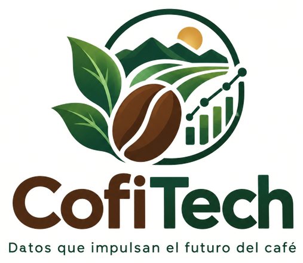

# CofiTech · Sistema de IA para el café colombiano
## Entrega Final · Inteligencia Artificial 2026-1

**Universidad Autónoma de Occidente · Ingeniería de Datos e IA**

**Autores:** Yáxul Santiago Cárdenas · Yesenia Díaz Urrego



---

## ¿Qué es?

CofiTech es una plataforma web con **dos vistas según el rol**, que comparten los mismos datos (Opción 3 del AHP, ver `00_documentos/AHP_seleccion_mockup.md`):

| Rol | Para qué sirve |
|---|---|
| **Caficultor** (celular) | Ver el día de su finca, diagnosticar una hoja con la cámara, saber qué hacer, proyectar cosecha e ingreso y vender su café directo a compradores. |
| **Agrónomo / Cooperativa** (escritorio) | Ver el panorama de su zona: alertas de roya a partir de las fotos de los caficultores, indicadores municipales, escenarios de precio, oferta de café por municipio y consola técnica con el asistente. |

La finca se registra una sola vez y todas las pantallas la usan: el diagnóstico ajusta la proyección de cosecha y llega como contexto al asistente.

## Qué hace

| Módulo | Técnica | Dónde |
|---|---|---|
| Diagnóstico de enfermedades foliares (roya, gotera, cercospora, phoma, minador, araña roja, sana) | CNN con Grad-CAM | `pages/4_Enfermedades.py`, `cofitech/vision.py`, NB08 |
| Qué hacer frente a la roya según la incidencia en el lote (umbral 5 %), sin inventar dosis | Reglas + agente RAG | `cofitech/prescripcion.py`, `06_agente_rag/` |
| Rendimiento e ingreso por municipio | Datos EVA + simulador agroclimático experimental | `pages/2_Rendimiento.py`, `cofitech/rendimiento.py` |
| Precio interno FNC | Simulador Ridge validado + modelos experimentales de NB10 | `pages/3_Precios.py`, `cofitech/precios_ridge.py` |
| Anomalías de precio | Volatilidad móvil sin datos futuros (Autoencoder y VAE en NB12) | `vistas/anomalias_precios.py` |
| Alertas fitosanitarias por municipio | Mapa de calor sobre los diagnósticos de campo | `vistas/alertas_fitosanitarias.py` |
| Venta directa (lotes, ofertas, chat) | Tablas transaccionales en PostgreSQL | `vistas/vender.py`, `vistas/lotes_zona.py`, `cofitech/mercado.py` |
| Asistente agronómico | RAG: LangChain + ChromaDB + Groq u Ollama | `pages/5_Chatbot.py`, `06_agente_rag/rag_pipeline.py` |
| Telemetría y KPIs (solo administradores) | Eventos de uso y votos 👍/👎 | `vistas/telemetria.py`, `cofitech/telemetria.py` |

Requerimientos funcionales y no funcionales completos: `00_documentos/Especificacion_sistema_CofiTech.md`.

---

## Inicio rápido

Los datos procesados (`01_datos/procesados/`) y los modelos entrenados (`04_modelos_entrenados/`) vienen en el repositorio: no hay que descargar ni entrenar nada para usar la app.

```powershell
git clone https://github.com/y4xulSC/IA_Entrega_Final.git
cd IA_Entrega_Final
python -m venv .venv
.\.venv\Scripts\Activate.ps1          # Linux/Mac: source .venv/bin/activate
pip install -r 07_app_web/requirements.txt
python 06_agente_rag/rag_pipeline.py indexar
cd 07_app_web
python -m streamlit run app.py
```

Abre http://localhost:8501. Sin base de datos la app funciona y guarda lo que produce en `05_resultados/`.

**Para la instalación completa** (archivo `.env`, base de datos PostgreSQL o Supabase con los datos cargados, acceso de administrador, pruebas y despliegue) sigue **[INSTALL.md](INSTALL.md)**.

---

## Cómo se conectan las piezas

```
01_datos/procesados/*.csv ──────────────► App Streamlit (07_app_web) ◄──► Agente RAG (06_agente_rag)
        │                                        │
        │ 02_carga_inicial.py                     │ diagnósticos, telemetría, lotes, ofertas, mensajes
        ▼                                        ▼
PostgreSQL / Supabase · esquema cafe ───────────────────────────────────────────
  esquema en estrella (dim_*, fact_*)      tablas de la app (registro_*, mk_*)
```

- La app **lee** los datos históricos de los CSV procesados; no depende del esquema en estrella.
- La app **escribe** en PostgreSQL (Supabase en la nube) lo que generan los usuarios. Si la base no responde, sigue funcionando con archivos locales y lo avisa en pantalla.
- El esquema en estrella con los datos históricos se carga con `03_scripts/bd/02_carga_inicial.py` para análisis y consultas SQL.

---

## Estructura de carpetas

```
IA_Entrega_Final/
├── 00_documentos/             # Especificación, AHP, bitácora, láminas del MockUp, documento académico
├── 01_datos/
│   ├── procesados/            # *_validado.csv y master_cafe_*.csv (en git)
│   ├── enriquecidos/          # Fuentes descargadas (clima, precios, DEM)
│   └── imagenes_cafe/         # Imágenes para entrenar la CNN (no están en git)
├── 02_notebooks/              # NB07–NB12
├── 03_scripts/
│   ├── descarga/              # Descarga de fuentes externas
│   ├── etl/                   # Limpieza y validación → *_validado.csv
│   ├── utilidades/            # Dataset maestro municipal
│   ├── bd/                    # DDL, esquema Supabase, carga inicial y cliente de la app
│   └── ahp/                   # AHP de la selección del MockUp
├── 04_modelos_entrenados/     # .keras y .pkl usados por la app
├── 05_resultados/             # Figuras, tablas, reportes, logs y respaldo local de la app
├── 06_agente_rag/             # Pipeline RAG y documentos fuente
├── 07_app_web/                # App Streamlit (app.py, pages/, vistas/, cofitech/, tests/)
├── 08_docker/                 # Configuración Docker heredada (el despliegue oficial no usa Docker)
├── 09_presentacion/           # Guion y presentación
├── 10_diccionario_datos/      # Diccionario de datos
├── INSTALL.md                 # Instalación paso a paso
└── README.md                  # Este archivo
```

---

## Estado de los modelos

| Modelo | Resultado | Cómo se usa en la app |
|---|---|---|
| Precio interno FNC · Ridge log-log (arábica Brasil + TRM) | Validación en los últimos 24 meses: R² = 0,989 y MAPE = 2,5 % (referencia ingenua: R² = 0,89 y MAPE = 6,1 %) | Simulador de escenarios, no pronóstico: usa el precio internacional del mismo mes |
| Rendimiento municipal (EVA) | Prueba temporal 2016–2018: repetir el año anterior obtuvo R² = 0,60; el mejor modelo con clima y ENSO, 0,28 | La cifra principal es el dato EVA; el modelo agroclimático queda como simulador experimental |
| NB09 · ML municipal | R² = 0,818, pero calculado sobre datos simulados | No se presenta como resultado real |
| Redes recurrentes y Transformer (NB10) | En calibración | Pestaña «Modelos experimentales» de Precios |
| CNN de enfermedades (NB08) | 7 clases con Grad-CAM; inferencia p95 = 0,65 s en CPU | Diagnóstico por foto y muestreo de la finca |
| Agente RAG | Responde con fuente; las dosis solo pueden salir de documentos de Cenicafé validados | Asistente y consola técnica |

Detalle y advertencias en la **Ficha técnica de modelos** de la app (solo administradores) y en `00_documentos/Especificacion_sistema_CofiTech.md`.

---

## Cobertura por unidad del syllabus

| Unidad | Tema | Notebook(s) / Módulo |
|--------|------|----------------------|
| **I** | Introducción a la IA, riesgos y oportunidades | `00_documentos/Documento_Final_IA_Cafe.md` (cap. 1) |
| **II** | ML clásico (regresión, clasificación, agrupamiento, sesgos) | NB09, NB11 |
| **III** | Redes neuronales (perceptrón, superficial, profunda, optimizadores) | NB07 |
| **IV** | CNN (inspiración biológica, arquitecturas, Grad-CAM) | NB08 |
| **IV** | Series secuenciales (LSTM, GRU, Atención, Transformer) | NB10 |
| **IV** | Generativas (Autoencoder, VAE) | NB12 |
| **IV** | PLN (embeddings, transformers, RAG) | `06_agente_rag/` |
| **Transversal** | Ingeniería de datos, BD, despliegue | `03_scripts/`, `07_app_web/` |

---

## Decisiones técnicas

| Tema | Decisión | Por qué |
|------|----------|---------|
| App | Streamlit con navegación por rol (`st.navigation`) | Un solo código para la vista móvil del caficultor y la consola de la cooperativa |
| Base de datos | PostgreSQL: esquema en estrella + tablas de la app; Supabase en la nube | Gratis, sin servidor propio; idéntico en local para pgAdmin |
| Despliegue | Streamlit Community Cloud + Supabase, sin Docker | Restricción del proyecto: presupuesto cero |
| Agente | RAG con Groq (u Ollama local) | Gratis y sin entrenar un LLM |
| Seguridad | Secretos en `.env` / `secrets.toml` (fuera de git); RLS sin políticas en Supabase; contraseña de administrador con hash PBKDF2 | La llave pública de Supabase no lee nada; la app no guarda datos personales |
| Selección del MockUp | AHP de Saaty con vector propio principal (`03_scripts/ahp/ahp_cofitech.py`) | Decisión multicriterio reproducible (CR < 0,10 en todas las matrices) |

---

## Pruebas

```powershell
pip install pytest
cd 07_app_web
python -m pytest tests -q
```

Las pruebas de base de datos solo corren con `COFITECH_TEST_DB_URL` apuntando a una base **de pruebas**: borran registros. Detalle en INSTALL.md.

---

## Documentos de soporte

- **Especificación del sistema** (RF, RNF, restricciones, matriz de innovación): `00_documentos/Especificacion_sistema_CofiTech.md`
- **Selección del MockUp por AHP:** `00_documentos/AHP_seleccion_mockup.md` y el tablero `CofiTech_AHP_Seleccion_Mockup.png`
- **Bitácora de decisiones y hallazgos:** `00_documentos/Bitacora_MockUp_decisiones_y_hallazgos.md`
- **Documento académico:** `00_documentos/Documento_Final_IA_Cafe.md` y `.docx`
- **Diccionario de datos:** `10_diccionario_datos/DICCIONARIO_DATOS.md`
- **Presentación:** `09_presentacion/`
- **README por módulo:** `03_scripts/bd/`, `03_scripts/descarga/`, `03_scripts/etl/`, `03_scripts/utilidades/`, `06_agente_rag/`

---

## Limitaciones conocidas

- Las imágenes de entrenamiento vienen de datasets foráneos (Brasil, Ecuador); la captura propia es trabajo futuro. El Grad-CAM a veces atiende al fondo y no a la lesión.
- Los datos tienen fecha de corte: precio FNC a diciembre de 2025 y ENSO a marzo de 2026. Cada cifra en pantalla muestra su fecha.
- Los compradores de «Vender mi café» son **de demostración**: la app responde por ellos y la pantalla lo dice.
- Los roles Caficultor y Agrónomo no tienen inicio de sesión; solo la administración está protegida.
- El corpus del asistente todavía no incluye los documentos de Cenicafé validados: sin ellos, el asistente no da dosis.

Lista completa y pendientes en la bitácora.

---

## Licencia y créditos

Datos públicos del MADR (EVA), FNC, IDEAM, NOAA, DANE (DIVIPOLA), Banco Mundial, FRED, IMF y datasets académicos abiertos (RoCoLe, BRACOL, JMuBEN, CALIBRO). Modelos con TensorFlow, scikit-learn, XGBoost, LightGBM y LangChain. Letra Inter bajo licencia OFL (`07_app_web/static/fonts/OFL-Inter.txt`). Atribuciones completas en el documento académico.

---

*Noviembre 2026 · Universidad Autónoma de Occidente*
